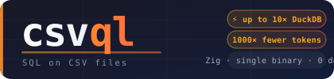

<p align="center">
  
</p>

[](https://github.com/melihbirim/csvql/actions/workflows/ci.yml)
[](LICENSE.md)
[](https://github.com/melihbirim/csvql/releases)

**Read-only SQL on CSV files, in place, for AI agents.**

> A database is something you load your data *into*. csvql is a query you run on the data where it already lives.

csvql runs `SELECT` on CSV files where they sit: no import, no ingest, no server. It is about as fast as DuckDB and polars on raw CSV and uses 3 to 11x less memory. It ships as an [MCP](https://modelcontextprotocol.io/) server, so an agent can ask a question of a gigabyte file and get back a few rows instead of the file. One static Zig binary, no network calls, no way to write to your data.

```bash
$ csvql "SELECT cab_type, COUNT(*) FROM 'trips.csv' GROUP BY cab_type"
cab_type,COUNT(*)
green,32447
yellow,967553
```

[Website](https://melihbirim.github.io/csvql/) · [Quick Start](#quick-start) · [For agents](#for-agents-mcp) · [Install](#installation) · [Performance](#performance) · [SQL](#sql) · [Docs](#documentation)

---

## Why this exists

Agents are getting access to company data. The usual paths are a database connection or uploading files to the model. Both move the data. csvql is the third option: run it next to the data, on your own box, and let the agent query it there. Everything below is checkable in the source.

- **Read-only by construction.** The parser has no `INSERT`, `UPDATE`, `DELETE` or `DROP`. Nothing writes to an input file.
- **No network.** No `std.net`, `std.http` or socket call in the codebase. No telemetry, no update check. `strace -f -e trace=network` shows an empty trace.
- **Sandboxed by a flag.** `--root /data` confines every file the process can open. `/etc/passwd` and `../` traversal fail with `PathOutsideAllowedRoot`.
- **Bounded output.** MCP results are capped at about 100 rows / 12 KB per call. A careless `SELECT *` cannot flood the context or pull a table out one call at a time.
- **Flat memory.** An aggregate holds a running accumulator, not a dataset: 74 MB on a 0.7 GB file and 74 MB on an 8 GB one. It fits on the small VM beside the data.
- **Auditable.** `--audit <file>` appends one JSONL record per query. Over SSH you inherit your existing keys, bastion and logs.

Full posture, including two known gaps on macOS and Windows: [SECURITY.md](SECURITY.md).

## What it does not do

- **It is not a database.** No `UNION`, no window functions, no `LEFT`/`RIGHT`/`FULL`/`CROSS JOIN` (inner hash join only). The only subquery shape is `col IN (SELECT ...)`. These error rather than return wrong data. If you need full SQL, use DuckDB.
- **Scalar functions in `WHERE`** are limited to `DATEDIFF`, `DATEADD` and `EXTRACT`. Others (`UPPER`, `ROUND`, ...) are `SELECT`-only and currently fail in `WHERE` with a misleading `ColumnNotFound`.
- **Quoted CSV is about 3x slower** than unquoted. Quotes disable the 16-byte skip the scanner relies on.
- **`MEDIAN` buffers every value in a group**, so on 20M rows it is 5x slower than DuckDB ([#205](https://github.com/melihbirim/csvql/issues/205)). High-cardinality `GROUP BY` (millions of groups) is also slower.
- **CSV only.** JSON and JSONL are output formats, not input formats.

Full list with tracking issues: [SQL_REFERENCE.md#known-limitations](SQL_REFERENCE.md#known-limitations).

## Quick Start

```bash
# SQL mode
csvql "SELECT name, salary FROM 'data.csv' WHERE age > 30 ORDER BY salary DESC LIMIT 10"

# Simple mode: same query, positional
csvql data.csv "name,salary" "age>30" 10 "salary:desc"

# Pipes
cat data.csv | csvql "SELECT name, age FROM '-' WHERE age > 25"
csvql "SELECT * FROM 'data.csv' WHERE status = 'active'" > output.csv

# Other formats
csvql "SELECT name, age FROM 'data.tsv'" -d $'\t'
csvql "SELECT name, age FROM 'data.csv' LIMIT 3" --json      # or --jsonl, --markdown

# What is in this file?
csvql --schema data.csv
```

Flags: `-d/--delimiter`, `--json`, `--jsonl`, `--markdown`, `--no-header`, `--no-input-header` (headerless files get `c1..cN`), `-o/--output`, `--threads`, `--strict`, `--schema`, `--root`, `--audit`, `--mcp`. Details in `csvql --help`. Simple mode: [SIMPLE_QUERY_LANGUAGE.md](SIMPLE_QUERY_LANGUAGE.md).

## For agents (MCP)

### Setup

```bash
csvql install          # registers csvql in Claude Code and Claude Desktop; --print to dry-run
```

It runs `claude mcp add` if the Claude Code CLI is present and merges an `mcpServers.csvql` entry into the Claude Desktop config, preserving your other servers. Restart Claude afterward.

Alternatives: a one-click `csvql-<platform>.mcpb` bundle for Claude Desktop on the [Releases](https://github.com/melihbirim/csvql/releases) page (Settings → Extensions), or a manual entry:

```json
{ "mcpServers": { "csvql": { "command": "/usr/local/bin/csvql", "args": ["--mcp", "--root", "/data"] } } }
```

VS Code (Copilot) takes the same `command`/`args` under `servers` in `.vscode/mcp.json` with `"type": "stdio"`.

### Tools

| Tool | Returns |
|------|---------|
| `csv_query(sql)` | Results as JSON, capped at about 100 rows / 12 KB |
| `csv_schema(file)` | Column names and a few sample rows |
| `csv_list(directory?)` | CSV files in a directory |

The agent writes ordinary SQL against single-quoted paths:

```sql
SELECT customer, SUM(revenue) AS total FROM 'sales.csv' GROUP BY customer ORDER BY total DESC LIMIT 10
SELECT STRFTIME('%Y-%m', order_date) AS month, COUNT(*) FROM 'orders.csv' GROUP BY month ORDER BY 1
SELECT o.id, c.name FROM 'orders.csv' o JOIN 'customers.csv' c ON o.customer_id = c.id WHERE c.region = 'West'
```

### Remote and on-prem

Run csvql on the server next to the data and connect over SSH. Only the SQL and the small result cross the wire. No open port, no reverse proxy, no new credentials:

```jsonc
// client MCP config; csvql runs on the remote server
{ "command": "ssh", "args": ["analyst@dataserver", "csvql", "--mcp", "--root", "/data"] }
```

Always set `--root` when an agent or another user can reach csvql. Pair it with an unprivileged OS user and a read-only mount. Checklist: [SECURITY.md#hardening-for-on-prem-and-remote-access](SECURITY.md#hardening-for-on-prem-and-remote-access).

### Token cost

Five questions about a taxi dataset cost about 640 tokens over MCP, tool schema included, and the cost does not change with file size. Pasting the 417 MB file would cost about 230 million tokens, which is a feasibility argument, not a savings figure. An agent that already has a shell and runs `duckdb -csv` uses slightly fewer tokens than csvql over MCP, because MCP returns JSON. The case for csvql with agents is `--root`, read-only execution, the output cap and memory, not token count. Measure it: [`bench/bench_tokens.py`](bench/bench_tokens.py).

## Installation

**Homebrew** (macOS / Linux):

```bash
brew install melihbirim/csvql/csvql
```

**Prebuilt binaries** from [GitHub Releases](https://github.com/melihbirim/csvql/releases):

```bash
# macOS (Apple Silicon)
curl -L https://github.com/melihbirim/csvql/releases/latest/download/csvql-macos-aarch64.tar.gz | tar xz
sudo mv csvql-macos-aarch64 /usr/local/bin/csvql

# macOS (Intel)
curl -L https://github.com/melihbirim/csvql/releases/latest/download/csvql-macos-x86_64.tar.gz | tar xz
sudo mv csvql-macos-x86_64 /usr/local/bin/csvql

# Linux (x86_64)
curl -L https://github.com/melihbirim/csvql/releases/latest/download/csvql-linux-x86_64.tar.gz | tar xz
sudo mv csvql-linux-x86_64 /usr/local/bin/csvql
```

Windows (x86_64): download `csvql-windows-x86_64.zip` from the same page and put `csvql-windows-x86_64.exe` on your `PATH`.

**Libraries**, same engine, no subprocess:

```bash
pip install csvql-query      # Python: csvql.query(), .query_df(), .query_csv()   → docs/PYTHON.md
npm install csvql-query      # Node.js: require('csvql-query'), plus a `csvql-query` CLI → docs/NODE.md
```

**From source**, Zig 0.15.2:

```bash
git clone https://github.com/melihbirim/csvql.git && cd csvql
zig build -Doptimize=ReleaseFast
sudo cp zig-out/bin/csvql /usr/local/bin/
```

## Performance

Same `GROUP BY department` on raw CSV, one process per engine, Apple M2 Pro with 16 GB. Peak memory and wall time:

| File | csvql | DuckDB | polars 2.0 |
| --- | --- | --- | --- |
| 0.69 GB | **74 MB** / 0.2s | 254 MB / 0.8s | 1151 MB / 0.6s |
| 1.89 GB | **74 MB** / 0.4s | 253 MB / 1.2s | 2107 MB / 1.1s |
| 3.80 GB | **75 MB** / 0.7s | 275 MB / 2.1s | 2666 MB / 9.8s |
| 8.14 GB | **74 MB** / 2.4s | 367 MB / 5.5s | 1754 MB / 26.7s |

Memory is flat because an aggregate holds an accumulator, not a dataset. That holds for aggregates, not for `ORDER BY`, which has to keep rows. Speed is in the same band as the other two: csvql is 2 to 5x ahead on scans, filters and small files, far ahead on joins against raw CSV, level with polars on `COUNT(*)` and top-N, and behind DuckDB on `MEDIAN` and on `GROUP BY` with millions of groups. None of that matters on an agent's timescale. The memory does, because it decides what box csvql can run on.

Every number has a reproduce script. Full tables, including quoted CSV, wide files, joins, subqueries and the losses: **[BENCHMARKS.md](BENCHMARKS.md)**.

## SQL

`SELECT` / `FROM` / `WHERE` / `GROUP BY` / `HAVING` / `ORDER BY` / `LIMIT` / `OFFSET`, inner `JOIN` (chained), `col IN (SELECT ...)`, `LIKE` / `ILIKE` / `BETWEEN` / `IS NULL` / `AND` / `OR` / `NOT`, `DISTINCT`, `CASE WHEN`. Aggregates: `COUNT`, `SUM`, `AVG`, `MIN`, `MAX`, `VARIANCE`, `STDDEV`, `MEDIAN`, `QUANTILE`, `MODE`, `GROUP_CONCAT`, `COUNT(DISTINCT)`. Scalars in `SELECT`: string (`UPPER`, `LOWER`, `TRIM`, `LENGTH`, `REVERSE`, `CONCAT`, `LTRIM`, `RTRIM`, `LEFT`, `RIGHT`, `REPEAT`, `POSITION`, `INSTR`, `SUBSTR`, `REPLACE`, `SPLIT_PART`, `LPAD`, `RPAD`), math (`ABS`, `SIGN`, `CEIL`, `FLOOR`, `MOD`, `ROUND`, `TRUNC`, `SQRT`, `POWER`, `LN`, `LOG`, `EXP`, `GREATEST`, `LEAST`), `CAST`, `COALESCE`, `NULLIF`, `IFNULL`, dates (`STRFTIME`, `DATE_PART`, `EXTRACT`, `DATEDIFF`, `DATEADD`, `CURRENT_DATE`, `NOW()`, `CURRENT_TIMESTAMP`).

```bash
csvql "SELECT department, COUNT(*), AVG(salary) FROM 'data.csv' WHERE salary > 50000 GROUP BY department HAVING COUNT(*) > 10 ORDER BY department"
csvql "SELECT e.name, d.dept_name FROM 'employees.csv' e JOIN 'departments.csv' d ON e.dept_id = d.id WHERE d.dept_name = 'Engineering'"
csvql "SELECT id FROM 'orders.csv' WHERE customer_id IN (SELECT id FROM 'customers.csv' WHERE region = 'EU')"
```

Full syntax and limitations: **[SQL_REFERENCE.md](SQL_REFERENCE.md)**. What is differentially tested against DuckDB: **[CORRECTNESS.md](CORRECTNESS.md)**.

## Documentation

| Document | Description |
| --- | --- |
| [SQL_REFERENCE.md](SQL_REFERENCE.md) | Full SQL syntax, runnable examples, DuckDB differences, limitations |
| [SECURITY.md](SECURITY.md) | Security posture, network and disk-write guarantees, hardening |
| [CORRECTNESS.md](CORRECTNESS.md) | What is tested against DuckDB, how, known gaps, error behaviour |
| [BENCHMARKS.md](BENCHMARKS.md) | Full performance analysis vs DuckDB, polars, pandas, DataFusion |
| [ARCHITECTURE.md](ARCHITECTURE.md) | Engine design, optimization techniques |
| [SIMPLE_QUERY_LANGUAGE.md](SIMPLE_QUERY_LANGUAGE.md) | Simple mode syntax reference |
| [docs/PYTHON.md](docs/PYTHON.md) · [docs/NODE.md](docs/NODE.md) · [docs/LIBRARY.md](docs/LIBRARY.md) | Python, Node.js and Zig library APIs |
| [CONTRIBUTING.md](CONTRIBUTING.md) | Contribution guidelines |

## Planned

- HTTP/SSE MCP transport, so one csvql can serve a team as a shared service ([#60](https://github.com/melihbirim/csvql/issues/60)).
- `MEDIAN` in O(groups) memory ([#205](https://github.com/melihbirim/csvql/issues/205)).
- Shell completions, help wanted ([#73](https://github.com/melihbirim/csvql/issues/73)).

Shipped features are in the [release notes](https://github.com/melihbirim/csvql/releases). [Good first issues](https://github.com/melihbirim/csvql/labels/good%20first%20issue) are scoped with file pointers and done-when criteria.

## License

MIT, see [LICENSE.md](LICENSE.md).
